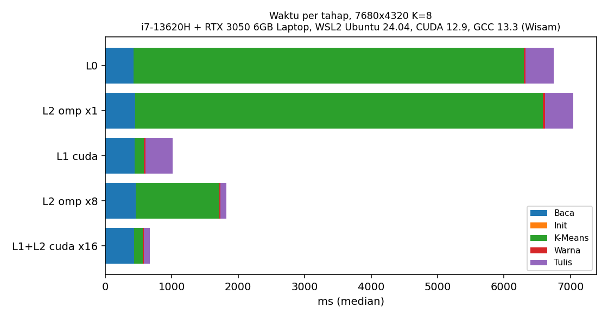
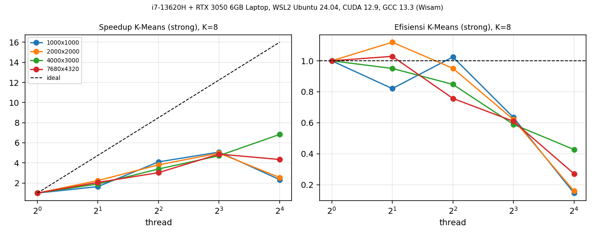
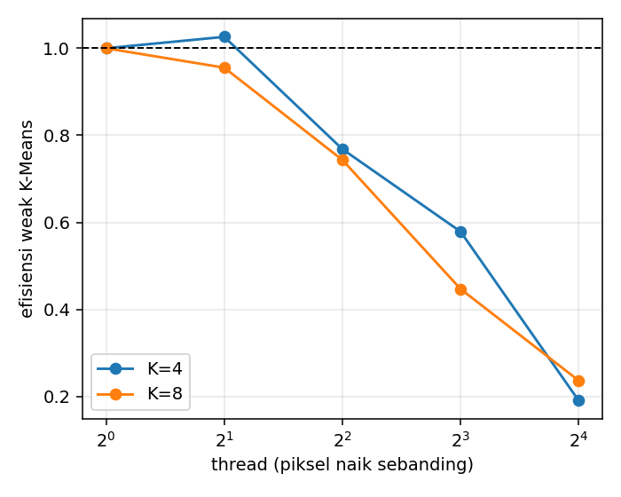

# Analisis scaling benchmark

Mesin: **i7-13620H + RTX 3050 6GB Laptop, WSL2 Ubuntu 24.04, CUDA 12.9, GCC 13.3 (Wisam)**. Sumber: `bench_gpu_summary.csv`, `run_20261127_1634_ksweep_summary.csv`, `run_20261127_1634_weak_summary.csv`, `run_20261127_1634_cudavar_summary.csv`. Dibuat oleh `bench/analyze_scaling.py` dari CSV hasil ukur; tidak ada angka yang diisi manual. Semua hasil sudah ditandai identik dengan acuan oleh `run_bench.py` (centroid dan counts); verifikasi label penuh adalah tugas modul verifikasi.

Sesi pengukuran: strong scaling K=8 ukuran 1000, 2000, 7680 dari 27 Nov (bench_gpu); sapuan K, weak scaling, varian CUDA, dan strong 4000x3000 dari run 27 Nov 16:34. Pada baris ganda, run 16:34 yang dipakai. Angka dua sesi tidak identik.

Angka dari mesin berbeda tidak boleh dicampur dalam satu tabel.

## 1. Waktu per tahap (ms) dan porsi dari total

Median dari 5 pengulangan setelah 1 pemanasan. Persen = porsi terhadap Total konfigurasi itu sendiri. `L1+L2 cuda xT` = K-Means di GPU dengan baca/tulis/warna OpenMP T thread; `L2 omp xT` = K-Means OpenMP dengan baca/tulis/warna OpenMP T thread.

**4000x3000, K=2**

| Konfigurasi | Baca | Init | K-Means | Warna | Tulis | Total |
|---|---|---|---|---|---|---|
| L0 | 167.2 (19%) | 0.0 (0%) | 640.7 (73%) | 10.0 (1%) | 50.4 (6%) | 875.1 |
| L2 omp x1 | 182.5 (18%) | 0.0 (0%) | 772.5 (76%) | 10.9 (1%) | 52.1 (5%) | 1019.8 |
| L2 omp x2 | 167.9 (26%) | 0.0 (0%) | 411.1 (65%) | 8.8 (1%) | 31.6 (5%) | 634.5 |
| L2 omp x4 | 162.6 (37%) | 0.0 (0%) | 243.8 (56%) | 6.8 (2%) | 20.1 (5%) | 439.0 |
| L2 omp x8 | 157.6 (42%) | 0.0 (0%) | 197.0 (52%) | 7.0 (2%) | 16.6 (4%) | 379.5 |
| L2 omp x16 | 157.9 (36%) | 0.0 (0%) | 256.7 (59%) | 6.4 (1%) | 18.8 (4%) | 437.8 |
| L1 cuda | 161.2 (59%) | 0.0 (0%) | 57.4 (21%) | 9.4 (3%) | 48.2 (18%) | 275.5 |
| L1+L2 cuda x2 | 166.8 (63%) | 0.0 (0%) | 59.6 (22%) | 7.2 (3%) | 29.4 (11%) | 265.3 |
| L1+L2 cuda x4 | 161.0 (65%) | 0.0 (0%) | 56.3 (23%) | 6.9 (3%) | 27.7 (11%) | 248.7 |
| L1+L2 cuda x8 | 166.2 (64%) | 0.0 (0%) | 63.5 (24%) | 7.9 (3%) | 20.6 (8%) | 261.2 |
| L1+L2 cuda x16 | 184.3 (61%) | 0.0 (0%) | 61.4 (20%) | 15.4 (5%) | 36.2 (12%) | 301.8 |

**4000x3000, K=4**

| Konfigurasi | Baca | Init | K-Means | Warna | Tulis | Total |
|---|---|---|---|---|---|---|
| L0 | 156.1 (13%) | 0.0 (0%) | 1017.2 (83%) | 9.6 (1%) | 51.9 (4%) | 1224.8 |
| L2 omp x1 | 155.0 (11%) | 0.0 (0%) | 1127.5 (83%) | 9.4 (1%) | 56.7 (4%) | 1360.4 |
| L2 omp x2 | 168.4 (19%) | 0.0 (0%) | 654.9 (76%) | 8.9 (1%) | 33.7 (4%) | 865.8 |
| L2 omp x4 | 164.9 (34%) | 0.0 (0%) | 302.2 (62%) | 6.7 (1%) | 18.7 (4%) | 490.1 |
| L2 omp x8 | 201.0 (39%) | 0.0 (0%) | 292.2 (56%) | 9.0 (2%) | 26.2 (5%) | 520.6 |
| L2 omp x16 | 162.2 (27%) | 0.0 (0%) | 376.1 (62%) | 14.5 (2%) | 29.0 (5%) | 603.6 |
| L1 cuda | 164.1 (52%) | 0.0 (0%) | 59.6 (19%) | 11.2 (4%) | 52.7 (17%) | 314.6 |
| L1+L2 cuda x2 | 155.5 (62%) | 0.0 (0%) | 56.3 (23%) | 7.0 (3%) | 27.2 (11%) | 249.1 |
| L1+L2 cuda x4 | 160.1 (64%) | 0.0 (0%) | 56.2 (22%) | 6.8 (3%) | 22.2 (9%) | 251.1 |
| L1+L2 cuda x8 | 165.6 (60%) | 0.0 (0%) | 69.6 (25%) | 6.8 (2%) | 15.2 (5%) | 276.3 |
| L1+L2 cuda x16 | 166.6 (61%) | 0.0 (0%) | 65.1 (24%) | 7.6 (3%) | 18.9 (7%) | 271.1 |

**1000x1000, K=8**

| Konfigurasi | Baca | Init | K-Means | Warna | Tulis | Total |
|---|---|---|---|---|---|---|
| L0 | 13.2 (6%) | 0.0 (0%) | 207.5 (87%) | 0.7 (0%) | 17.4 (7%) | 237.4 |
| L2 omp x1 | 13.5 (5%) | 0.0 (0%) | 220.7 (87%) | 0.8 (0%) | 17.0 (7%) | 252.4 |
| L2 omp x2 | 14.5 (9%) | 0.0 (0%) | 134.5 (82%) | 0.6 (0%) | 14.4 (9%) | 164.1 |
| L2 omp x4 | 13.6 (16%) | 0.0 (0%) | 53.8 (65%) | 0.4 (1%) | 13.6 (16%) | 82.9 |
| L2 omp x8 | 13.8 (19%) | 0.0 (0%) | 43.5 (59%) | 0.4 (1%) | 15.7 (21%) | 73.7 |
| L2 omp x16 | 13.9 (10%) | 0.0 (0%) | 94.5 (71%) | 4.8 (4%) | 24.5 (18%) | 132.9 |
| L1 cuda | 14.3 (38%) | 0.0 (0%) | 4.8 (13%) | 0.7 (2%) | 16.6 (44%) | 37.4 |
| L1+L2 cuda x2 | 13.3 (39%) | 0.0 (0%) | 5.1 (15%) | 0.6 (2%) | 12.1 (35%) | 34.5 |
| L1+L2 cuda x4 | 14.0 (32%) | 0.0 (0%) | 5.0 (11%) | 0.5 (1%) | 15.1 (34%) | 43.8 |
| L1+L2 cuda x8 | 13.2 (35%) | 0.0 (0%) | 5.1 (14%) | 0.5 (1%) | 16.1 (43%) | 37.3 |
| L1+L2 cuda x16 | 13.3 (27%) | 0.0 (0%) | 5.0 (10%) | 2.9 (6%) | 25.5 (52%) | 48.7 |

**2000x2000, K=8**

| Konfigurasi | Baca | Init | K-Means | Warna | Tulis | Total |
|---|---|---|---|---|---|---|
| L0 | 52.9 (6%) | 0.0 (0%) | 777.4 (84%) | 4.0 (0%) | 85.8 (9%) | 921.7 |
| L2 omp x1 | 54.2 (6%) | 0.0 (0%) | 819.5 (85%) | 3.4 (0%) | 84.5 (9%) | 960.9 |
| L2 omp x2 | 53.6 (11%) | 0.0 (0%) | 365.9 (77%) | 2.5 (1%) | 44.9 (9%) | 477.0 |
| L2 omp x4 | 52.7 (17%) | 0.0 (0%) | 215.3 (69%) | 2.3 (1%) | 34.0 (11%) | 312.4 |
| L2 omp x8 | 52.3 (21%) | 0.0 (0%) | 165.0 (67%) | 2.0 (1%) | 23.6 (10%) | 245.1 |
| L2 omp x16 | 57.9 (13%) | 0.0 (0%) | 321.4 (72%) | 15.1 (3%) | 45.2 (10%) | 444.1 |
| L1 cuda | 52.4 (33%) | 0.0 (0%) | 18.5 (12%) | 3.5 (2%) | 82.0 (51%) | 159.5 |
| L1+L2 cuda x2 | 52.9 (44%) | 0.0 (0%) | 17.0 (14%) | 2.3 (2%) | 45.2 (38%) | 119.1 |
| L1+L2 cuda x4 | 52.1 (46%) | 0.0 (0%) | 17.9 (16%) | 2.0 (2%) | 34.3 (30%) | 112.7 |
| L1+L2 cuda x8 | 56.4 (48%) | 0.0 (0%) | 23.3 (20%) | 2.3 (2%) | 27.7 (24%) | 116.5 |
| L1+L2 cuda x16 | 57.2 (45%) | 0.0 (0%) | 20.9 (17%) | 11.4 (9%) | 39.8 (32%) | 126.2 |

**4000x3000, K=8**

| Konfigurasi | Baca | Init | K-Means | Warna | Tulis | Total |
|---|---|---|---|---|---|---|
| L0 | 161.5 (6%) | 0.0 (0%) | 2385.1 (87%) | 11.8 (0%) | 215.2 (8%) | 2750.3 |
| L2 omp x1 | 175.1 (6%) | 0.0 (0%) | 2304.5 (84%) | 13.8 (1%) | 252.0 (9%) | 2740.4 |
| L2 omp x2 | 182.1 (12%) | 0.0 (0%) | 1212.2 (78%) | 8.5 (1%) | 134.5 (9%) | 1558.3 |
| L2 omp x4 | 171.2 (18%) | 0.0 (0%) | 679.5 (72%) | 6.8 (1%) | 75.6 (8%) | 945.1 |
| L2 omp x8 | 172.1 (24%) | 0.0 (0%) | 488.5 (68%) | 6.8 (1%) | 54.6 (8%) | 717.5 |
| L2 omp x16 | 159.9 (29%) | 0.0 (0%) | 337.3 (60%) | 8.7 (2%) | 53.9 (10%) | 560.7 |
| L1 cuda | 161.6 (37%) | 0.0 (0%) | 55.7 (13%) | 9.5 (2%) | 205.5 (47%) | 436.2 |
| L1+L2 cuda x2 | 173.6 (48%) | 0.0 (0%) | 63.8 (17%) | 8.4 (2%) | 130.8 (36%) | 364.5 |
| L1+L2 cuda x4 | 164.1 (52%) | 0.0 (0%) | 60.0 (19%) | 9.7 (3%) | 76.7 (24%) | 317.0 |
| L1+L2 cuda x8 | 163.8 (56%) | 0.0 (0%) | 55.4 (19%) | 7.0 (2%) | 55.4 (19%) | 291.9 |
| L1+L2 cuda x16 | 180.3 (52%) | 0.0 (0%) | 59.5 (17%) | 13.9 (4%) | 82.3 (24%) | 344.2 |

**7680x4320, K=8**

| Konfigurasi | Baca | Init | K-Means | Warna | Tulis | Total |
|---|---|---|---|---|---|---|
| L0 | 431.3 (6%) | 0.0 (0%) | 5870.6 (87%) | 24.0 (0%) | 419.3 (6%) | 6765.7 |
| L2 omp x1 | 451.4 (6%) | 0.0 (0%) | 6133.4 (86%) | 30.3 (0%) | 425.9 (6%) | 7093.2 |
| L2 omp x2 | 441.4 (12%) | 0.0 (0%) | 2980.6 (80%) | 20.4 (1%) | 226.5 (6%) | 3717.8 |
| L2 omp x4 | 449.5 (17%) | 0.0 (0%) | 2025.2 (76%) | 17.9 (1%) | 132.8 (5%) | 2661.1 |
| L2 omp x8 | 457.4 (24%) | 0.0 (0%) | 1258.0 (67%) | 17.6 (1%) | 93.9 (5%) | 1875.9 |
| L2 omp x16 | 457.9 (23%) | 0.0 (0%) | 1414.1 (70%) | 28.0 (1%) | 104.7 (5%) | 2031.8 |
| L1 cuda | 440.0 (43%) | 0.0 (0%) | 138.9 (13%) | 26.5 (3%) | 411.3 (40%) | 1033.1 |
| L1+L2 cuda x2 | 434.8 (51%) | 0.0 (0%) | 162.0 (19%) | 19.9 (2%) | 215.3 (25%) | 858.8 |
| L1+L2 cuda x4 | 455.2 (60%) | 0.0 (0%) | 148.5 (19%) | 17.2 (2%) | 132.9 (17%) | 764.3 |
| L1+L2 cuda x8 | 462.6 (63%) | 0.0 (0%) | 161.0 (22%) | 16.2 (2%) | 95.1 (13%) | 738.9 |
| L1+L2 cuda x16 | 435.6 (64%) | 0.0 (0%) | 131.8 (19%) | 18.6 (3%) | 88.0 (13%) | 684.1 |

**4000x3000, K=16**

| Konfigurasi | Baca | Init | K-Means | Warna | Tulis | Total |
|---|---|---|---|---|---|---|
| L0 | 170.7 (3%) | 0.0 (0%) | 4794.6 (89%) | 13.8 (0%) | 417.7 (8%) | 5400.7 |
| L2 omp x1 | 157.2 (3%) | 0.0 (0%) | 4497.5 (88%) | 10.0 (0%) | 407.0 (8%) | 5095.3 |
| L2 omp x2 | 173.7 (6%) | 0.0 (0%) | 2402.8 (85%) | 7.4 (0%) | 230.1 (8%) | 2811.5 |
| L2 omp x4 | 219.9 (11%) | 0.0 (0%) | 1494.7 (78%) | 7.2 (0%) | 147.7 (8%) | 1913.2 |
| L2 omp x8 | 160.4 (14%) | 0.0 (0%) | 907.0 (78%) | 6.5 (1%) | 99.1 (8%) | 1168.3 |
| L2 omp x16 | 159.3 (17%) | 0.0 (0%) | 684.2 (74%) | 6.4 (1%) | 81.4 (9%) | 927.9 |
| L1 cuda | 159.9 (26%) | 0.0 (0%) | 59.7 (10%) | 8.5 (1%) | 380.9 (62%) | 609.9 |
| L1+L2 cuda x2 | 155.6 (36%) | 0.0 (0%) | 49.9 (12%) | 7.3 (2%) | 212.7 (49%) | 432.8 |
| L1+L2 cuda x4 | 156.3 (44%) | 0.0 (0%) | 53.5 (15%) | 6.8 (2%) | 135.2 (38%) | 357.1 |
| L1+L2 cuda x8 | 176.5 (50%) | 0.0 (0%) | 53.7 (15%) | 6.6 (2%) | 111.9 (31%) | 355.6 |
| L1+L2 cuda x16 | 154.9 (52%) | 0.0 (0%) | 50.5 (17%) | 7.0 (2%) | 79.2 (26%) | 300.6 |

## 2. Sebelum dan sesudah tiap langkah optimasi (L0 → L1 → L2 → L1+L2)

Speedup terhadap L0 pada citra dan K yang sama. Kolom K-Means memakai `kmeans_ms`; kolom Total memakai `total_ms` (tanpa pemanasan konteks CUDA, lihat bagian 7). Konfigurasi terbaik dipilih dari Total.

| Citra | K | Konfigurasi | K-Means (ms) | Speedup K-Means | Total (ms) | Speedup Total | Di luar K-Means (ms) |
|---|---|---|---|---|---|---|---|
| 4000x3000 | 2 | L0 | 640.7 | 1.0x | 875.1 | 1.00x | 227.6 |
| 4000x3000 | 2 | L2 omp x8 | 197.0 | 3.3x | 379.5 | 2.31x | 181.2 |
| 4000x3000 | 2 | L1 cuda | 57.4 | 11.2x | 275.5 | 3.18x | 218.8 |
| 4000x3000 | 2 | L1+L2 cuda x4 | 56.3 | 11.4x | 248.7 | 3.52x | 195.6 |
| 4000x3000 | 4 | L0 | 1017.2 | 1.0x | 1224.8 | 1.00x | 217.6 |
| 4000x3000 | 4 | L2 omp x4 | 302.2 | 3.4x | 490.1 | 2.50x | 190.3 |
| 4000x3000 | 4 | L1 cuda | 59.6 | 17.1x | 314.6 | 3.89x | 228.1 |
| 4000x3000 | 4 | L1+L2 cuda x2 | 56.3 | 18.1x | 249.1 | 4.92x | 189.7 |
| 1000x1000 | 8 | L0 | 207.5 | 1.0x | 237.4 | 1.00x | 31.3 |
| 1000x1000 | 8 | L2 omp x8 | 43.5 | 4.8x | 73.7 | 3.22x | 29.9 |
| 1000x1000 | 8 | L1 cuda | 4.8 | 42.9x | 37.4 | 6.35x | 31.6 |
| 1000x1000 | 8 | L1+L2 cuda x2 | 5.1 | 40.6x | 34.5 | 6.89x | 26.0 |
| 2000x2000 | 8 | L0 | 777.4 | 1.0x | 921.7 | 1.00x | 142.8 |
| 2000x2000 | 8 | L2 omp x8 | 165.0 | 4.7x | 245.1 | 3.76x | 77.9 |
| 2000x2000 | 8 | L1 cuda | 18.5 | 41.9x | 159.5 | 5.78x | 138.0 |
| 2000x2000 | 8 | L1+L2 cuda x4 | 17.9 | 43.4x | 112.7 | 8.18x | 88.5 |
| 4000x3000 | 8 | L0 | 2385.1 | 1.0x | 2750.3 | 1.00x | 388.6 |
| 4000x3000 | 8 | L2 omp x16 | 337.3 | 7.1x | 560.7 | 4.90x | 222.4 |
| 4000x3000 | 8 | L1 cuda | 55.7 | 42.8x | 436.2 | 6.31x | 376.6 |
| 4000x3000 | 8 | L1+L2 cuda x8 | 55.4 | 43.1x | 291.9 | 9.42x | 226.2 |
| 7680x4320 | 8 | L0 | 5870.6 | 1.0x | 6765.7 | 1.00x | 874.6 |
| 7680x4320 | 8 | L2 omp x8 | 1258.0 | 4.7x | 1875.9 | 3.61x | 569.0 |
| 7680x4320 | 8 | L1 cuda | 138.9 | 42.3x | 1033.1 | 6.55x | 877.8 |
| 7680x4320 | 8 | L1+L2 cuda x16 | 131.8 | 44.6x | 684.1 | 9.89x | 542.2 |
| 4000x3000 | 16 | L0 | 4794.6 | 1.0x | 5400.7 | 1.00x | 602.2 |
| 4000x3000 | 16 | L2 omp x16 | 684.2 | 7.0x | 927.9 | 5.82x | 247.1 |
| 4000x3000 | 16 | L1 cuda | 59.7 | 80.3x | 609.9 | 8.86x | 549.3 |
| 4000x3000 | 16 | L1+L2 cuda x16 | 50.5 | 95.0x | 300.6 | 17.97x | 241.2 |

## 3. Strong scaling OpenMP (ukuran tetap, thread naik)

Basis = `L2 omp x1` (bukan L0), supaya overhead OpenMP tidak tercampur ke efisiensi. Dua sudut pandang: **K-Means saja** (komputasi murni) dan **Total** (termasuk tahap serial seperti baca PNG). Selisih keduanya adalah bagian yang tidak ikut menskala. `e` = fraksi serial Karp-Flatt.

**4000x3000, K=2**

| T | K-Means (ms) | S K-Means | E K-Means | e K-Means | Total (ms) | S Total | E Total | E Tulis |
|---|---|---|---|---|---|---|---|---|
| 1 | 772.5 | 1.00x | 1.00 | - | 1019.8 | 1.00x | 1.00 | 1.00 |
| 2 | 411.1 | 1.88x | 0.94 | 0.064 | 634.5 | 1.61x | 0.80 | 0.82 |
| 4 | 243.8 | 3.17x | 0.79 | 0.088 | 439.0 | 2.32x | 0.58 | 0.65 |
| 8 | 197.0 | 3.92x | 0.49 | 0.149 | 379.5 | 2.69x | 0.34 | 0.39 |
| 16 | 256.7 | 3.01x | 0.19 | 0.288 | 437.8 | 2.33x | 0.15 | 0.17 |

**4000x3000, K=4**

| T | K-Means (ms) | S K-Means | E K-Means | e K-Means | Total (ms) | S Total | E Total | E Tulis |
|---|---|---|---|---|---|---|---|---|
| 1 | 1127.5 | 1.00x | 1.00 | - | 1360.4 | 1.00x | 1.00 | 1.00 |
| 2 | 654.9 | 1.72x | 0.86 | 0.162 | 865.8 | 1.57x | 0.79 | 0.84 |
| 4 | 302.2 | 3.73x | 0.93 | 0.024 | 490.1 | 2.78x | 0.69 | 0.76 |
| 8 | 292.2 | 3.86x | 0.48 | 0.153 | 520.6 | 2.61x | 0.33 | 0.27 |
| 16 | 376.1 | 3.00x | 0.19 | 0.289 | 603.6 | 2.25x | 0.14 | 0.12 |

**1000x1000, K=8**

| T | K-Means (ms) | S K-Means | E K-Means | e K-Means | Total (ms) | S Total | E Total | E Tulis |
|---|---|---|---|---|---|---|---|---|
| 1 | 220.7 | 1.00x | 1.00 | - | 252.4 | 1.00x | 1.00 | 1.00 |
| 2 | 134.5 | 1.64x | 0.82 | 0.219 | 164.1 | 1.54x | 0.77 | 0.59 |
| 4 | 53.8 | 4.10x | 1.02 | -0.008 | 82.9 | 3.04x | 0.76 | 0.31 |
| 8 | 43.5 | 5.07x | 0.63 | 0.082 | 73.7 | 3.43x | 0.43 | 0.14 |
| 16 | 94.5 | 2.34x | 0.15 | 0.390 | 132.9 | 1.90x | 0.12 | 0.04 |

**2000x2000, K=8**

| T | K-Means (ms) | S K-Means | E K-Means | e K-Means | Total (ms) | S Total | E Total | E Tulis |
|---|---|---|---|---|---|---|---|---|
| 1 | 819.5 | 1.00x | 1.00 | - | 960.9 | 1.00x | 1.00 | 1.00 |
| 2 | 365.9 | 2.24x | 1.12 | -0.107 | 477.0 | 2.01x | 1.01 | 0.94 |
| 4 | 215.3 | 3.81x | 0.95 | 0.017 | 312.4 | 3.08x | 0.77 | 0.62 |
| 8 | 165.0 | 4.97x | 0.62 | 0.087 | 245.1 | 3.92x | 0.49 | 0.45 |
| 16 | 321.4 | 2.55x | 0.16 | 0.352 | 444.1 | 2.16x | 0.14 | 0.12 |

**4000x3000, K=8**

| T | K-Means (ms) | S K-Means | E K-Means | e K-Means | Total (ms) | S Total | E Total | E Tulis |
|---|---|---|---|---|---|---|---|---|
| 1 | 2304.5 | 1.00x | 1.00 | - | 2740.4 | 1.00x | 1.00 | 1.00 |
| 2 | 1212.2 | 1.90x | 0.95 | 0.052 | 1558.3 | 1.76x | 0.88 | 0.94 |
| 4 | 679.5 | 3.39x | 0.85 | 0.060 | 945.1 | 2.90x | 0.72 | 0.83 |
| 8 | 488.5 | 4.72x | 0.59 | 0.099 | 717.5 | 3.82x | 0.48 | 0.58 |
| 16 | 337.3 | 6.83x | 0.43 | 0.089 | 560.7 | 4.89x | 0.31 | 0.29 |

**7680x4320, K=8**

| T | K-Means (ms) | S K-Means | E K-Means | e K-Means | Total (ms) | S Total | E Total | E Tulis |
|---|---|---|---|---|---|---|---|---|
| 1 | 6133.4 | 1.00x | 1.00 | - | 7093.2 | 1.00x | 1.00 | 1.00 |
| 2 | 2980.6 | 2.06x | 1.03 | -0.028 | 3717.8 | 1.91x | 0.95 | 0.94 |
| 4 | 2025.2 | 3.03x | 0.76 | 0.107 | 2661.1 | 2.67x | 0.67 | 0.80 |
| 8 | 1258.0 | 4.88x | 0.61 | 0.092 | 1875.9 | 3.78x | 0.47 | 0.57 |
| 16 | 1414.1 | 4.34x | 0.27 | 0.179 | 2031.8 | 3.49x | 0.22 | 0.25 |

**4000x3000, K=16**

| T | K-Means (ms) | S K-Means | E K-Means | e K-Means | Total (ms) | S Total | E Total | E Tulis |
|---|---|---|---|---|---|---|---|---|
| 1 | 4497.5 | 1.00x | 1.00 | - | 5095.3 | 1.00x | 1.00 | 1.00 |
| 2 | 2402.8 | 1.87x | 0.94 | 0.068 | 2811.5 | 1.81x | 0.91 | 0.88 |
| 4 | 1494.7 | 3.01x | 0.75 | 0.110 | 1913.2 | 2.66x | 0.67 | 0.69 |
| 8 | 907.0 | 4.96x | 0.62 | 0.088 | 1168.3 | 4.36x | 0.55 | 0.51 |
| 16 | 684.2 | 6.57x | 0.41 | 0.096 | 927.9 | 5.49x | 0.34 | 0.31 |

## 4. Weak scaling OpenMP (beban per thread tetap)

Piksel = beban dasar x T. Efisiensi weak = t(T=1) / t(T), ideal 1,0. Dihitung untuk **K-Means saja** dan **Total**. Total biasanya jatuh karena baca PNG serial ikut membesar bersama citra.

**K=4**

| T | Ukuran | Piksel (juta) | K-Means (ms) | E weak K-Means | Total (ms) | E weak Total |
|---|---|---|---|---|---|---|
| 1 | 2000x1000 | 2.0 | 197.5 | 1.00 | 237.1 | 1.00 |
| 2 | 4000x1000 | 4.0 | 192.4 | 1.03 | 264.0 | 0.90 |
| 4 | 8000x1000 | 8.0 | 257.1 | 0.77 | 389.6 | 0.61 |
| 8 | 16000x1000 | 16.0 | 341.3 | 0.58 | 598.5 | 0.40 |
| 16 | 32000x1000 | 32.0 | 1038.3 | 0.19 | 1679.0 | 0.14 |

**K=8**

| T | Ukuran | Piksel (juta) | K-Means (ms) | E weak K-Means | Total (ms) | E weak Total |
|---|---|---|---|---|---|---|
| 1 | 2000x1000 | 2.0 | 343.0 | 1.00 | 415.0 | 1.00 |
| 2 | 4000x1000 | 4.0 | 359.0 | 0.96 | 455.1 | 0.91 |
| 4 | 8000x1000 | 8.0 | 461.5 | 0.74 | 626.9 | 0.66 |
| 8 | 16000x1000 | 16.0 | 767.7 | 0.45 | 1100.5 | 0.38 |
| 16 | 32000x1000 | 32.0 | 1451.7 | 0.24 | 2148.1 | 0.19 |

## 5. Throughput K-Means menurut ukuran citra (analog weak scaling untuk GPU)

ns per piksel per iterasi = `kmeans_ms` x 1e6 / (piksel x iterasi). Nilai yang datar terhadap ukuran berarti waktu tumbuh linear dengan beban; nilai yang turun berarti biaya tetap (peluncuran kernel, transfer awal) makin terbagi.

**K=2**

| Citra | Piksel (juta) | L0 | L2 omp x1 | L2 omp x2 | L2 omp x4 | L2 omp x8 | L2 omp x16 | L1 cuda |
|---|---|---|---|---|---|---|---|---|
| 4000x3000 | 12.00 | 2.67 | 3.22 | 1.71 | 1.02 | 0.82 | 1.07 | 0.24 |

**K=4**

| Citra | Piksel (juta) | L0 | L2 omp x1 | L2 omp x2 | L2 omp x4 | L2 omp x8 | L2 omp x16 | L1 cuda |
|---|---|---|---|---|---|---|---|---|
| 4000x3000 | 12.00 | 4.24 | 4.70 | 2.73 | 1.26 | 1.22 | 1.57 | 0.25 |

**K=8**

| Citra | Piksel (juta) | L0 | L2 omp x1 | L2 omp x2 | L2 omp x4 | L2 omp x8 | L2 omp x16 | L1 cuda |
|---|---|---|---|---|---|---|---|---|
| 1000x1000 | 1.00 | 10.37 | 11.03 | 6.72 | 2.69 | 2.17 | 4.72 | 0.24 |
| 2000x2000 | 4.00 | 9.72 | 10.24 | 4.57 | 2.69 | 2.06 | 4.02 | 0.23 |
| 4000x3000 | 12.00 | 9.94 | 9.60 | 5.05 | 2.83 | 2.04 | 1.41 | 0.23 |
| 7680x4320 | 33.18 | 8.85 | 9.24 | 4.49 | 3.05 | 1.90 | 2.13 | 0.21 |

**K=16**

| Citra | Piksel (juta) | L0 | L2 omp x1 | L2 omp x2 | L2 omp x4 | L2 omp x8 | L2 omp x16 | L1 cuda |
|---|---|---|---|---|---|---|---|---|
| 4000x3000 | 12.00 | 19.98 | 18.74 | 10.01 | 6.23 | 3.78 | 2.85 | 0.25 |

## 6. Pengaruh jumlah cluster K

K-Means (ms) per K. Rasio terhadap K terkecil menunjukkan apakah waktu tumbuh linear terhadap K (OpenMP/CPU diharapkan mendekati linear; CUDA lebih datar).

**4000x3000**

| Konfigurasi | K=2 | K=4 | K=8 | K=16 |
|---|---|---|---|---|
| L0 | 640.7 (1.00x) | 1017.2 (1.59x) | 2385.1 (3.72x) | 4794.6 (7.48x) |
| L2 omp x1 | 772.5 (1.00x) | 1127.5 (1.46x) | 2304.5 (2.98x) | 4497.5 (5.82x) |
| L2 omp x2 | 411.1 (1.00x) | 654.9 (1.59x) | 1212.2 (2.95x) | 2402.8 (5.85x) |
| L2 omp x4 | 243.8 (1.00x) | 302.2 (1.24x) | 679.5 (2.79x) | 1494.7 (6.13x) |
| L2 omp x8 | 197.0 (1.00x) | 292.2 (1.48x) | 488.5 (2.48x) | 907.0 (4.61x) |
| L2 omp x16 | 256.7 (1.00x) | 376.1 (1.46x) | 337.3 (1.31x) | 684.2 (2.67x) |
| L1 cuda | 57.4 (1.00x) | 59.6 (1.04x) | 55.7 (0.97x) | 59.7 (1.04x) |
| L1+L2 cuda x2 | 59.6 (1.00x) | 56.3 (0.94x) | 63.8 (1.07x) | 49.9 (0.84x) |
| L1+L2 cuda x4 | 56.3 (1.00x) | 56.2 (1.00x) | 60.0 (1.06x) | 53.5 (0.95x) |
| L1+L2 cuda x8 | 63.5 (1.00x) | 69.6 (1.09x) | 55.4 (0.87x) | 53.7 (0.84x) |
| L1+L2 cuda x16 | 61.4 (1.00x) | 65.1 (1.06x) | 59.5 (0.97x) | 50.5 (0.82x) |

## 7. Bottleneck setelah optimasi dan batas Amdahl

Setelah K-Means dipercepat, tahap yang tidak ikut dipercepat menentukan batas. Kolom `Batas` = total konfigurasi / (total - K-Means) hanya sebagai ilustrasi: speedup tambahan paling besar yang masih mungkin bila K-Means menjadi 0 ms dan tahap lain tetap.

| Citra | K | Konfigurasi | Porsi K-Means | Tahap terbesar di luar K-Means | Batas |
|---|---|---|---|---|---|
| 4000x3000 | 2 | L1+L2 cuda x4 | 23% | Baca (65%) | 1.29x |
| 4000x3000 | 2 | L2 omp x8 | 52% | Baca (42%) | 2.08x |
| 4000x3000 | 4 | L1+L2 cuda x2 | 23% | Baca (62%) | 1.29x |
| 4000x3000 | 4 | L2 omp x4 | 62% | Baca (34%) | 2.61x |
| 1000x1000 | 8 | L1+L2 cuda x2 | 15% | Baca (39%) | 1.17x |
| 1000x1000 | 8 | L2 omp x8 | 59% | Tulis (21%) | 2.44x |
| 2000x2000 | 8 | L1+L2 cuda x4 | 16% | Baca (46%) | 1.19x |
| 2000x2000 | 8 | L2 omp x8 | 67% | Baca (21%) | 3.06x |
| 4000x3000 | 8 | L1+L2 cuda x8 | 19% | Baca (56%) | 1.23x |
| 4000x3000 | 8 | L2 omp x16 | 60% | Baca (29%) | 2.51x |
| 7680x4320 | 8 | L1+L2 cuda x16 | 19% | Baca (64%) | 1.24x |
| 7680x4320 | 8 | L2 omp x8 | 67% | Baca (24%) | 3.04x |
| 4000x3000 | 16 | L1+L2 cuda x16 | 17% | Baca (52%) | 1.20x |
| 4000x3000 | 16 | L2 omp x16 | 74% | Baca (17%) | 3.81x |

**Pemanasan konteks CUDA.** `total_ms` tidak memuat inisialisasi konteks CUDA (sekitar 250 ms pada pengukuran 22 Nov di kontrak U8; angka terbaru ada di `warmup_ms`), tetapi aplikasi menjalankan `landcover` sebagai proses baru tiap run, jadi pengguna membayarnya. Kolom `warmup_ms` dan `wall_ms` ada di CSV ini; lihat `docs/BENCH_tabel.md` untuk perbandingan Proses.

## 8. Varian CUDA (T3 simple, T4 shared, T5 streams), tahap K-Means saja

Dari `tests/bench_cuda` pada citra acak, bukan lewat `landcover`; sebab itu tidak mencakup baca/tulis. `landcover` belum bisa memanggil T3/T5, jadi L3 belum bisa diukur sebagai pipeline utuh.

| Ukuran | K | shared (ms) | simple (ms) | streams (ms) | x vs simple: shared | x vs simple: streams |
|---|---|---|---|---|---|---|
| 1000x1000 | 4 | 2.8 | 48.0 | 4.2 | 16.9x | 11.4x |
| 1000x1000 | 8 | 3.0 | 39.6 | 3.7 | 13.2x | 10.6x |
| 1000x1000 | 16 | 3.1 | 29.1 | 4.3 | 9.5x | 6.7x |
| 2000x2000 | 8 | 9.7 | 154.1 | 11.6 | 15.9x | 13.3x |
| 4000x3000 | 4 | 30.3 | 450.8 | 39.8 | 14.9x | 11.3x |
| 4000x3000 | 8 | 30.6 | 462.6 | 43.6 | 15.1x | 10.6x |
| 4000x3000 | 16 | 31.5 | 317.4 | 40.7 | 10.1x | 7.8x |
| 7680x4320 | 4 | 91.3 | 1233.5 | 96.4 | 13.5x | 12.8x |
| 7680x4320 | 8 | 98.1 | 1277.8 | 101.0 | 13.0x | 12.7x |
| 7680x4320 | 16 | 89.6 | 888.0 | 95.6 | 9.9x | 9.3x |

## Grafik

